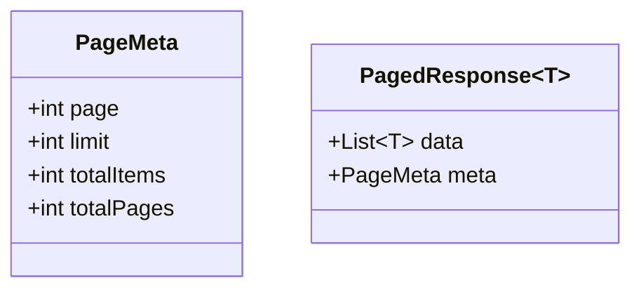
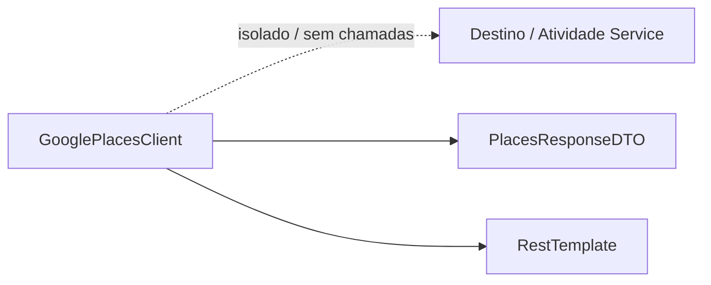
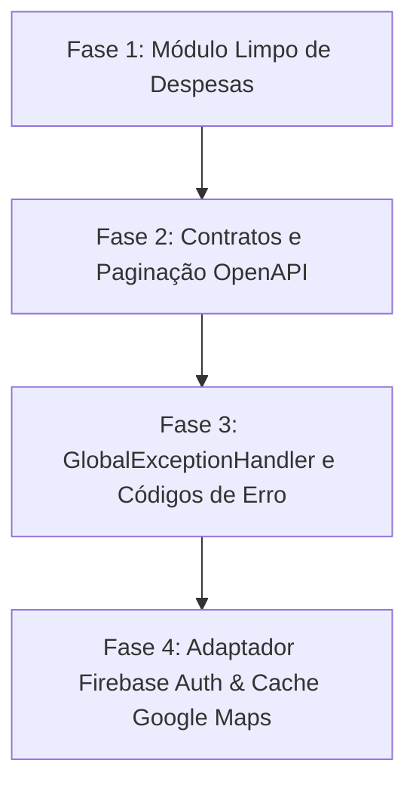

# Relatório de Conformidade Arquitetural e Contratual: ws-viaja-junto

> **Base de Referência:** 
> - Grafo de Código AST: [`graphify-out/graph.json`](../graphify-out/graph.json) (505 nós, 1710 arestas)
> - Contrato de API: [`docs/viajajunto-openapi.json`](viajajunto-openapi.json) (OpenAPI 3.0.3 v1.0.0)
> - Diretrizes e Plano de Reuso: `.antigravity/skills/expense-module-decoupling/SKILL.md`, `.antigravity/skills/backend-api-builder/SKILL.md`, `.antigravity/skills/external-services-adapter/SKILL.md`

---

## Sumário Executivo

A varredura completa do projeto `ws-viaja-junto` realizada a partir do grafo de código gerado pelo Graphify revelou que o projeto encontra-se em estado inicial/protótipo, apresentando **graves divergências estruturais e quebras de contrato** em relação ao OpenAPI v1.0.0 e às diretrizes do Plano de Reuso.

| Eixo Avaliado | Status | Nível de Risco | Principal Causa Raiz |
| :--- | :---: | :---: | :--- |
| **1. Desacoplamento de Despesas** | ❌ Não Conforme | **Crítico** | Módulo de divisão e saldos não existe; há apenas um `budget` acoplado diretamente a `Trip` e `Activity`. |
| **2. Fidelidade à OpenAPI v1.0.0** | ❌ Não Conforme | **Crítico** | Rotas e DTOs em português com prefixo `/api`; erro 400 genérico; ausência de envoltório de paginação `{data, meta}`. |
| **3. Serviços Externos** | ❌ Não Conforme | **Alto** | Autenticação local proprietária (JJWT + BCrypt) em vez de Firebase; `GooglePlacesClient` sem cache e sem adapter. |

---

## 1. Desacoplamento do Módulo de Despesas (Plano de Reuso)

### 1.1 Diagnóstico via Grafo Graphify (`graphify-out/graph.json`)
A análise de conectividade e comunidades do grafo revelou as seguintes arestas de acoplamento direto:
```mermaid
graph LR
    subgraph Modulo_Trip
        VE[ViagemEntity]
        TSS[TripSecurityService]
    end
    subgraph Modulo_Activity
        AVE[AtividadeViagemEntity]
        AVR[AtividadeViagemRepository]
    end
    subgraph Modulo_Budget_Atual
        OE[OrcamentoEntity]
        OS[OrcamentoService]
        OC[OrcamentoController]
    end

    OE -->|@OneToOne viagem| VE
    OS -->|import e injeção| AVR
    OS -->|import| AVE
    OS -->|validação de acesso| TSS
    OS -->|atualização de viagem| VE
    OC --> OS
```

- **Arestas AST detectadas no grafo:**
  - `OrcamentoService` $\to$ `ViagemEntity`
  - `OrcamentoService` $\to$ `AtividadeViagemEntity`
  - `OrcamentoService.getResumoOrcamento()` $\to$ `AtividadeViagemRepository.findAllByViagemId()`
  - `OrcamentoEntity` $\to$ `ViagemEntity` (`@OneToOne private ViagemEntity viagem`)
  - `ViagemService.deleteViagem()` $\to$ `OrcamentoRepository.deleteByViagemId()`

### 1.2 Inconformidades Identificadas

| Arquivo / Classe | Linha | Inconformidade | Ação Corretiva |
| :--- | :--- | :--- | :--- |
| `OrcamentoEntity.java` | L23-L25 | Importa e mapeia diretamente `ViagemEntity` via relacionamento JPA `@OneToOne`. Viola a Regra do Domínio Limpo. | Mover o conceito para o domínio de `Expense` utilizando identificadores neutros (`groupId`) sem anotações JPA cruzadas entre módulos. |
| `OrcamentoService.java` | L4-L12, L38 | Importa `AtividadeViagemEntity` e calcula o orçamento iterando sobre atividades de viagem (`a.getCustoPrevisto()`). | O cálculo de despesas e saldos deve operar sobre despesas registradas (`Expense`), e não calcular saldo subtraindo custo previsto de itinerário. |
| Módulo de Despesas (Geral) | — | **Ausência total dos tipos puros:** `Group`, `Participant`, `Expense`, `SplitType` (`equal`, `percentage`, `fixed`), `Balance` e `Transfer`. | Implementar pacote `com.viajajunto.api.modules.expense.domain` contendo os tipos de domínio limpo sem qualquer referência a pacotes de `trip`, `destination` ou `activity`. |
| Algoritmo de Quitação | — | Os endpoints `/trips/{tripId}/balances` e `/trips/{tripId}/settlements` **não existem**. Não há cálculo de saldo líquido (`net`) nem simplificação de dívidas. | Implementar algoritmo de quitação que calcula o balanço líquido de cada participante e gera o grafo bipartido mínimo de transferências (`Transfer: from, to, amount`). |

---

## 2. Fidelidade à OpenAPI v1.0.0

### 2.1 Padrão de Respostas Paginadas

> [!WARNING]
> **Violação do Padrão `{ data, meta }`:**
> Todas as rotas que realizam listagem retornam `org.springframework.data.domain.Page<T>` ou `java.util.List<T>` brutos, sem o envelope de metadados exigido pela OpenAPI e pela regra `backend-api-builder`.



| Arquivo / Método | Retorno Atual | Esperado na OpenAPI | Ação Corretiva |
| :--- | :--- | :--- | :--- |
| `ViagemController.listUserTrips` | `ResponseEntity<List<ViagemResponseDTO>>` | `GET /trips?page=1&limit=20`<br>`PagedResponse<Trip>` | Incluir parâmetros `@RequestParam(defaultValue="1") int page`, `@RequestParam(defaultValue="20") int limit` e encapsular em `PagedResponse<Trip>`. |
| `CatalogoAtividadeController.searchAtividades` | `ResponseEntity<Page<CatalogoAtividadeDTO>>` | `PagedResponse<Activity>` | Substituir serialização padrão do Spring Data pelo envelope padronizado `{ "data": [...], "meta": PageMeta }`. |
| `AvaliacaoController.listAvaliacoesByDestino` | `ResponseEntity<Page<AvaliacaoResponseDTO>>` | `GET /places/{placeId}/reviews`<br>`PagedResponse<Review>` | Alinhar path para `/places/{placeId}/reviews` e encapsular o resultado no padrão de paginação. |

### 2.2 Tratamento de Erros e `GlobalExceptionHandler`

> [!IMPORTANT]
> O schema `Error` da OpenAPI define a estrutura:
> ```json
> {
>   "code": "VALIDATION_ERROR",
>   "message": "Mensagem legível",
>   "details": [
>     { "field": "campo", "issue": "descrição do erro" }
>   ]
> }
> ```

A classe `ErrorResponseDTO.java` implementa:
```java
public class ErrorResponseDTO {
    private LocalDateTime timestamp;
    private int status;
    private String error;
    private String message;
    private String path;
    private Map<String, String> validationErrors; // Incompatível com o schema details[]
}
```

| Arquivo / Método | Código Atual | Código OpenAPI Esperado | Ação Corretiva |
| :--- | :--- | :--- | :--- |
| `GlobalExceptionHandler.handleValidationExceptions` | HTTP 400 Bad Request, mapa `validationErrors` | **HTTP 422 Unprocessable Entity**<br>`code: "VALIDATION_ERROR"`, `details: [{field, issue}]` | Alterar status para 422, adicionar campo `code: "VALIDATION_ERROR"` e converter `FieldError` em lista de detalhes. |
| `GlobalExceptionHandler.handleResourceNotFound` | Não possui campo `code` | **HTTP 404 Not Found**<br>`code: "NOT_FOUND"` | Adicionar `code: "NOT_FOUND"` ao DTO de erro. |
| `GlobalExceptionHandler.handleBusinessRule` | HTTP 400 genérico | **HTTP 409 Conflict** / **HTTP 422** | Mapear exceções específicas: `SCHEDULE_CONFLICT`, `REVIEW_EXISTS`, `EMAIL_IN_USE`. |
| `AvaliacaoService.createAvaliacao` | Não valida duplicidade | **HTTP 409 Conflict**<br>`code: "REVIEW_EXISTS"` | Lançar exceção com código `REVIEW_EXISTS` caso o usuário já tenha avaliado o local (`placeId`). |
| `AtividadeViagemService.addAtividade` | Não valida choque de horário | **HTTP 409 Conflict**<br>`code: "SCHEDULE_CONFLICT"` | Implementar verificação de sobreposição de horário para a mesma viagem e lançar código `SCHEDULE_CONFLICT`. |

### 2.3 Roteamento, Verbos e DTOs

| Recurso | OpenAPI v1.0.0 (Esperado) | Implementação Atual | Inconformidades |
| :--- | :--- | :--- | :--- |
| **Viagens** | `GET /trips`<br>`POST /trips`<br>`PATCH /trips/{tripId}`<br>`DELETE /trips/{tripId}` | `/api/viagens`<br>`PUT /api/viagens/{id}` | - Prefixo `/api` indevido<br>- Idioma em português<br>- Verbo `PUT` em vez de `PATCH`<br>- DTO sem `baseCurrency` e com campos em português |
| **Atividades** | `GET /trips/{tripId}/activities`<br>`POST /trips/{tripId}/activities`<br>`PATCH /trips/{tripId}/activities/{id}` | `/api/viagens/{vId}/destinos/{dId}/atividades` | - Aninhamento forçado sob `destinos/{dId}`<br>- DTO sem `startTime`, `endTime`, `estimatedCost`, `currency` |
| **Membros** | `GET /trips/{tripId}/members`<br>`POST /trips/{tripId}/members`<br>`PATCH /trips/{tripId}/members/{userId}` | `/api/viagens/{vId}/membros/join` | - POST requer rota de convite (`email`, `role`), não `/join`<br>- `PATCH` deve receber `userId`, não `membroId` interno |
| **Avaliações** | `GET /places/{placeId}/reviews`<br>`POST /places/{placeId}/reviews`<br>`PATCH /reviews/{reviewId}`<br>`DELETE /reviews/{reviewId}` | `POST /api/avaliacoes`<br>`GET /api/avaliacoes/destino/{id}` | - Não segue recurso `/places/{placeId}`<br>- Operações `PATCH` e `DELETE` inexistentes |
| **Despesas** | `GET /trips/{tripId}/expenses`<br>`POST /trips/{tripId}/expenses`<br>`GET /trips/{tripId}/balances`<br>`POST /trips/{tripId}/settlements` | `/api/viagens/{vId}/orcamento` | - Rota e recursos de despesas e divisões totalmente ausentes |
| **Usuário** | `GET /users/me`<br>`PATCH /users/me` | `GET /api/auth/me` | - Endpoint incorreto (`/auth/me` em vez de `/users/me`)<br>- Operação `PATCH` ausente |
| **Senha** | `POST /auth/password-reset` | `POST /api/auth/forgot-password` | - Path incompatível com o contrato OpenAPI |

---

## 3. Serviços Externos

### 3.1 Google Maps / Places & Directions API

O grafo revela que `GooglePlacesClient.java` possui **0 arestas de entrada**:


#### Inconformidades:
1. **Ausência de Abstração (Adapter Pattern):** O cliente é uma classe concreta `@Component` sem interface correspondente (`MapsPort` / `PlacesAdapter`), acoplando chamadas diretamente à implementação da Google API.
2. **Ausência de Cache:** Não há anotação `@Cacheable` nem configuração de `CacheManager` (Caffeine/Redis). Chamadas repetidas a lugares/geocodificação gerarão custos e latência excessivos.
3. **Google Directions / Routes Inexistente:** Os endpoints `GET /trips/{tripId}/map` e `GET /trips/{tripId}/route` não possuem suporte no backend.
4. **Desacoplamento do `placeId`:** O campo `placeId` do Google Maps não está integrado nos DTOs de `Destination` e `Activity`.

### 3.2 Autenticação (Firebase Auth vs JJWT Local)

O projeto implementa uma pilha completa de emissão de tokens locais com segredo HMAC:
- `JwtService.java`: assina JWTs com `io.jsonwebtoken` usando secret estático configurado no `application.properties`.
- `AuthService.java`: armazena e verifica hashes de senhas com BCrypt (`passwordEncoder.encode(dto.getSenha())`).
- `UserEntity.java`: possui coluna `senha` em banco relacional.

> [!CAUTION]
> **Quebra da Diretriz de Autenticação (`external-services-adapter`):**
> O backend **NÃO DEVE** emitir tokens próprios nem gerenciar senhas. O fluxo de credenciais é de responsabilidade estrita do **Firebase Authentication**. O backend deve atuar como Resource Server, apenas validando o Bearer Token JWT emitido pelo Firebase e mapeando o usuário via `firebaseUid`.

---

## 4. Plano de Ação Corretiva Priorizado



### Fase 1: Módulo Desacoplado de Despesas (Plano de Reuso)
1. Criar o pacote isolado `com.viajajunto.api.modules.expense.domain` contendo:
   - `Group`, `Participant`, `Expense`, `SplitType` (`EQUAL`, `PERCENTAGE`, `FIXED`), `Balance`, `Transfer`.
2. Implementar `BalanceSettlementService` contendo:
   - Validações de divisão de despesas:
     - `equal`: `share == null`
     - `percentage`: $\sum \text{share} = 100$
     - `fixed`: $\sum \text{share} = \text{amount}$
   - Algoritmo de compensação de saldos mínimos (algoritmo guloso de liquidação de dívidas com dois ponteiros para devedores e credores).
3. Expor os endpoints contratuais em `ExpenseController`:
   - `GET /trips/{tripId}/expenses`
   - `POST /trips/{tripId}/expenses`
   - `PATCH /trips/{tripId}/expenses/{expenseId}`
   - `DELETE /trips/{tripId}/expenses/{expenseId}`
   - `GET /trips/{tripId}/balances`
   - `POST /trips/{tripId}/settlements`
4. Desacoplar `OrcamentoService` para não importar `ViagemEntity` e `AtividadeViagemEntity`.

### Fase 2: Conformidade OpenAPI (Paths, DTOs e Paginação)
1. Criar classes genéricas `PagedResponse<T>` e `PageMeta(page, limit, totalItems, totalPages)`.
2. Renomear e alinhar os controladores para os caminhos da especificação (sem o prefixo `/api` e em inglês):
   - `ViagemController` $\to$ `/trips` (com verbos `PATCH`, DTOs em inglês e paginação em `GET /trips`).
   - `AtividadeViagemController` $\to$ `/trips/{tripId}/activities` (permitindo vincular `destinationId` opcional).
   - `DestinoViagemController` $\to$ `/trips/{tripId}/destinations`.
   - `MembroViagemController` $\to$ `/trips/{tripId}/members` com DTO de convite por email.
   - `AvaliacaoController` $\to$ `/places/{placeId}/reviews` e `/reviews/{reviewId}`.
   - `AuthController` / `UserController` $\to$ `/users/me`.

### Fase 3: Padronização de Erros (GlobalExceptionHandler)
1. Atualizar `ErrorResponseDTO.java` para conter exatamente:
   - `String code`
   - `String message`
   - `List<ErrorDetailDTO> details` (com `field` e `issue`)
2. Ajustar `GlobalExceptionHandler.java`:
   - Mapear `MethodArgumentNotValidException` para HTTP 422 com `code: "VALIDATION_ERROR"`.
   - Mapear `ResourceNotFoundException` para HTTP 404 com `code: "NOT_FOUND"`.
   - Criar exceções e mapeamentos para:
     - `SCHEDULE_CONFLICT` (HTTP 409)
     - `REVIEW_EXISTS` (HTTP 409)
     - `EMAIL_IN_USE` (HTTP 409)
     - `UNAUTHORIZED` (HTTP 401)
     - `FORBIDDEN` (HTTP 403)

### Fase 4: Adapters Externos (Firebase Auth & Google Maps)
1. **Firebase Auth:**
   - Adicionar dependência do Firebase Admin SDK ou configurar Spring Security OAuth2 Resource Server com `jwk-set-uri` do Google/Firebase.
   - Substituir o filtro `JwtAuthFilter` por um validador de token Firebase que extrai o UID e valida o cabeçalho `Authorization: Bearer <accessToken>`.
   - Remover armazenamento de senhas locais e geração interna de tokens HMAC.
2. **Google Maps / Places / Directions:**
   - Criar interface `MapsClientPort` e implementar padrão Adapter.
   - Habilitar `@EnableCaching` e adicionar anotação `@Cacheable(value = "placesCache", key = "#query")` no método de busca.
   - Implementar cliente da Directions API para atender os endpoints `GET /trips/{tripId}/map` e `GET /trips/{tripId}/route`.
